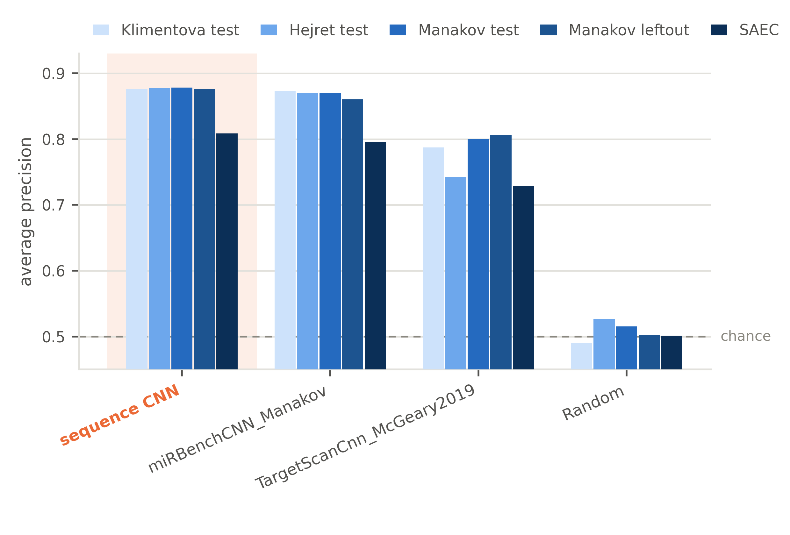

# MREseeker (CNN)

Predict whether a microRNA binds a candidate target site (MRE) on an mRNA, with a
**sequence CNN** that reads the raw miRNA and MRE sequences (~0.87 average
precision; chance = 0.5). No feature-extraction pass is needed, and `explain
--duplex` reports which bases pair and what kind of site the model relied on.



Published miRBench predictors re-run over the same five sets. Redraw with
`python3 src/figures/panel_benchmark_saec.py`, from `results/head_to_head.csv` and
`results/mirbench_predictor_evaluation.csv` (the only tracked files under `results/`).

`src/eqtl_analysis/` applies the CNN to GTEx eQTLs that fall in miRNA target sites.

Data: miRBench (Gresova et al., 2025), built on the AGO2 chimeric eCLIP of
Manakov et al. (2022).

---

## Installation

The environment is managed with [Pixi](https://pixi.prefix.dev/latest/installation/):

```bash
pixi install --manifest-path dependencies/cnn/pixi.toml    # PyTorch + Optuna (CUDA)
```

Each example first enters it with `pixi shell`, then runs the script.

---

## Sequence CNN

### Predict

```bash
pixi shell --manifest-path dependencies/cnn/pixi.toml
python3 src/cnn/predict_cnn.py --checkpoint cnn_checkpoints/cnn_branches_mirbind_embed16_restruct.pt --input pairs.tsv -o predictions.tsv --mre-col mre_sequence --mirna-col mirna_sequence
```

- Input is a TSV with one MRE and one miRNA sequence per row; no `label` needed.
- Rows are de-duplicated on the miRNA+MRE sequence; `--no-dedup` scores every row.
- `--threshold` (default 0.5) sets the binary call.
- Checkpoints are self-contained (they store their own `model_args`), so any
  single checkpoint or k-fold member can be used on its own.

### Train

```bash
pixi shell --manifest-path dependencies/cnn/pixi.toml
python3 src/training/cnn/cnn_branches_mirbind.py train --train train.tsv --val val.tsv --test test.tsv leftout.tsv --mre-col gene --mirna-col noncodingRNA --family-col noncodingRNA_fam --epochs 40 --batch-size 256 --lr 1e-3 --out cnn_checkpoints/cnn_mirbind.pt
```

- `--folds K` — stratified group k-fold by miRNA family, writes `*_fold{1..K}.pt`.
- `--oof-out FILE` — with `--folds`, also writes out-of-fold predictions.
- `--no-val` — fit on the full training set without a validation split.
- `--test` — scores one or more labelled sets with the saved checkpoint (best validation epoch, or the last one with `--no-val`).

### Evaluate

Scoring a labelled file (a `label` column) prints metrics. Every subcommand defaults to
`mre_sequence` / `mirna_sequence` columns, so v7 tables need `--mre-col gene --mirna-col noncodingRNA`:

```bash
pixi shell --manifest-path dependencies/cnn/pixi.toml
# single checkpoint
python3 src/training/cnn/cnn_branches_mirbind.py predict --checkpoint cnn_checkpoints/cnn_mirbind.pt --input test.tsv --output test_pred.tsv --mre-col gene --mirna-col noncodingRNA [--error-dump errors.tsv]

# average of k-fold checkpoints over several test sets
python3 src/training/cnn/cnn_branches_mirbind.py predict-ensemble --checkpoints cnn_checkpoints/cnn_mirbind_fold*.pt --inputs test.tsv leftout.tsv --output-dir predictions --mre-col gene --mirna-col noncodingRNA
```

### Explain: which bases pair, and what kind of site

`explain` runs Integrated Gradients on the 2D pairing matrix. With `--duplex` it also
decodes that attribution map into the duplex the model relied on: an antiparallel,
bulge-tolerant alignment through the matrix (`src/training/cnn/duplex_decode.py`),
steered by the attribution (`--duplex-lambda`, 0 = sequence-only duplex).

```bash
python3 src/training/cnn/cnn_branches_mirbind.py explain \
    --checkpoint cnn_checkpoints/cnn_branches_mirbind_embed16_restruct.pt \
    --input pairs.tsv --output explain.tsv --mre-col gene --mirna-col noncodingRNA \
    --duplex --duplex-report duplex.txt --report-top 50 --dump-matrix attr.npz
python3 src/cnn/plot_duplex.py --explain explain.tsv --npz attr.npz --out-dir duplex_png --top 6
```

Added columns (all values in logits):

| column | meaning |
|---|---|
| `duplex_type` | binding type of the decoded duplex (same names as `binding_types.py`, plus `.bulge` for a seed bulge) |
| `seq_type` | strict-register, sequence-only type, for comparison |
| `duplex_pairs` | `pos:j:kind:attr;…` per miRNA position (1-based pos, 0-based MRE j; kind WC/GU/MM/bulge) |
| `dlogit_seed/central/supp/tail` | logit drop when the duplex cells of miRNA positions 1–8 / 9–12 / 13–17 / 18+ are zeroed |
| `dlogit_duplex`, `dlogit_random` | whole duplex zeroed vs. the same number of random cells (control) |
| `attr_*`, `duplex_frac` | IG mass on those cells; share of positive IG mass that sits on the duplex |

`duplex.txt` shows an IntaRNA-style diagram per row (`|` WC, `:` G·U, lower-case = unpaired,
`s` = seed 2–8, `3` = supplementary 13–16). On a 3,000-row GSE304955 sample, zeroing the
decoded duplex costs +0.41 logit on average, against 0.00 for random cells, and correlates
0.95 with logit − baseline. So the duplex accounts for the prediction, rather than just
being drawn over it. The type is most trustworthy where `prob` and `duplex_frac` are high.
On low-scoring pairs the attribution is diffuse and the decoded duplex is mostly chemistry.

### Hyper-parameter search

```bash
pixi shell --manifest-path dependencies/cnn/pixi.toml
python3 src/training/cnn/optuna_cnn_mirbind.py --train train.tsv --val val.tsv --mre-col gene --mirna-col noncodingRNA --trials 50 --epochs 30 --ckpt-dir optuna_ckpts --storage optuna_mirbind.db
```

Maximises validation AUPRC (TPE sampler, median pruner). Every checkpoint it
writes can be scored directly with `predict_cnn.py`.

### Wider MRE windows (150 / 225 / 300 nt)

The shipped CNN sees the 50-nt chimera window. These checkpoints see the same window plus genomic
flank on each side (mRNA sense), so they can use sites and context just outside it:

| checkpoint | window | flank 5' / 3' | MRE column | `MRESEEKER_MRE_LEN` |
|---|---|---|---|---|
| `cnn_checkpoints/cnn_mre150.pt` | 150 nt | 50 / 50 | `gene150` | `150` |
| `cnn_checkpoints/cnn_mre225.pt` | 225 nt | 50 / 125 | `gene225` | `225` |
| `cnn_checkpoints/cnn_mre300.pt` | 300 nt | 125 / 125 | `gene300` | `300` |

**The window length is not stored in the checkpoint.** Set `MRESEEKER_MRE_LEN` to the value above for
both training and prediction. The network pools adaptively, so a wrong value still loads and
runs without an error, but the MRE is padded or truncated and the scores are wrong. Unset, it defaults to 50,
the shipped model.

```bash
MRESEEKER_MRE_LEN=300 pixi run --manifest-path dependencies/cnn/pixi.toml python3 src/cnn/predict_cnn.py \
    --checkpoint cnn_checkpoints/cnn_mre300.pt --input pairs.tsv -o predictions.tsv \
    --mre-col gene300 --mirna-col noncodingRNA
```

The input MRE must already be the full window (e.g. 300 nt, centred on the 50-nt site as in the
table). `src/cnn/build_mre150.py` makes such tables from v7 tables with genome coordinates:

```bash
python3 src/cnn/build_mre150.py                                                   # 150 nt -> data/mre150, column gene150
python3 src/cnn/build_mre150.py --up 50  --down 125 --col gene225 --out data/mre225
python3 src/cnn/build_mre150.py --up 125 --down 125 --col gene300 --out data/mre300
```

It fetches the flanks from the GRCh38 primary assembly, checks each window's centre against
`gene`, and writes N where a row has no coordinates, its centre does not match, or the window runs
past a chromosome end. It keeps the 50-nt `gene` column and splits the Manakov train set by
chromosome (chr2 = validation; the test set is chr1). Point it at your own files with
`--genome GRCh38.fa` (samtools-indexed, Ensembl chromosome names), `--src-dir` (miRBench v7 tables) and
`--novel-dir`. `--set NAME=PATH` adds any other v7 table, and `--only NAME …` builds a subset:

```bash
python3 src/cnn/build_mre150.py --genome GRCh38.fa --up 125 --down 125 --col gene300 \
    --set mysites=my_v7.tsv --only mysites --out data/mine
```

All three were trained with the same rows and recipe as a matched 50-nt retrain (the shipped
architecture with EMA; Manakov train minus chr2, validation on chr2, 30 epochs, patience 6):

```bash
export MRESEEKER_MRE_LEN=300          # 150 / 225 / 300
D=data/mre300; COL=gene300
python3 src/training/cnn/cnn_branches_mirbind.py train \
    --train $D/manakov_train_nochr2.tsv --val $D/manakov_val_chr2.tsv \
    --mre-col $COL --mirna-col noncodingRNA --family-col noncodingRNA_fam \
    --epochs 30 --patience 6 --batch-size 256 --lr 1e-3 \
    --seq-pairing embed --pair-embed-dim 16 --seq-pool gem --seq-filters 64 --seq-dim 128 \
    --n-conv-blocks 6 --n-pool-blocks 4 --block-pool max --ema \
    --out $D/cnn_mre300.pt
```

Test auPRC (every row scored, no de-duplication; the 50-nt column is the matched retrain, not the shipped
checkpoint):

| set | 50 nt | 150 nt | 225 nt | 300 nt |
|---|---|---|---|---|
| Manakov 2022 test (chr1) | 0.879 | 0.912 | 0.916 | 0.916 |
| Manakov 2022 left-out miRNAs | 0.877 | 0.909 | 0.910 | 0.910 |
| SAEC (GSE304955) | 0.812 | 0.822 | 0.824 | 0.824 |
| SUM159PT (GSE263552) | 0.767 | 0.791 | 0.795 | 0.795 |
| HSPC (GSE180129) | 0.849 | 0.866 | 0.872 | 0.873 |
| Kasumi-1 (GSE180129) | 0.800 | 0.819 | 0.825 | 0.827 |

The flank brings most of the gain at 150 nt. 300 nt adds a further 0.002–0.008, which comes
mostly from rows whose seed match lies 51–125 nt from the core. On the two small CLASH sets
(Hejret 2023, Klimentova 2022, ~1,000 rows each) the windows are within noise of each other.

---

## Repository layout

```
src/cnn/              CNN inference (predict_cnn.py), duplex plots (plot_duplex.py)
src/training/cnn/     CNN model + training/explain CLI, duplex decoder, Optuna search
src/eqtl_analysis/    GTEx eQTL scoring with the CNN
src/figures/          README benchmark panel (+ poster_style.py palette)
cnn_checkpoints/      shipped CNN checkpoint
data/                 eQTL fragment tables and the CNN-TP pair sets
dependencies/cnn/     Pixi manifest
```

---

## Citations

- Gresova, K., et al. (2025). miRBench datasets (v6). Zenodo. https://doi.org/10.5281/zenodo.14734014
- Manakov, S. A., et al. (2022). Scalable and deep profiling of mRNA targets for individual microRNAs with chimeric eCLIP. bioRxiv. https://doi.org/10.1101/2022.02.13.480296
